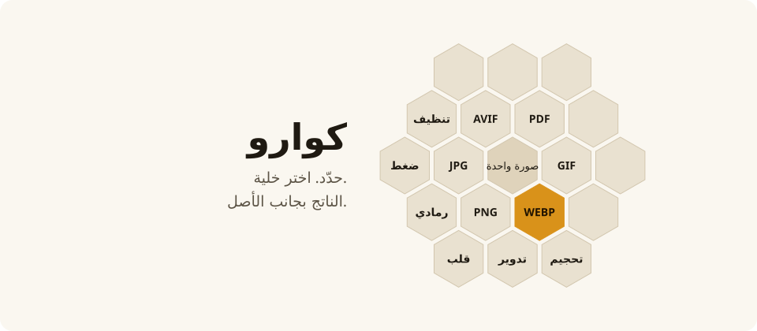
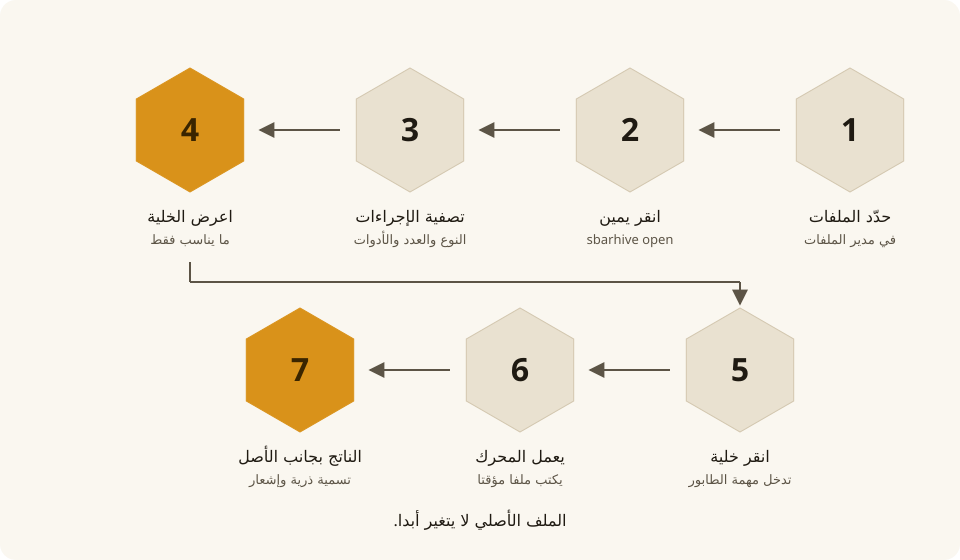
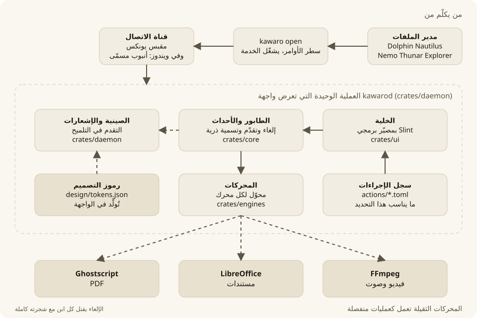
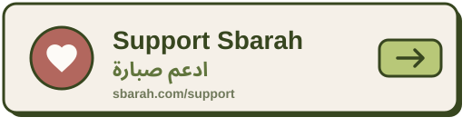

[English](README.md) | [العربية](README.ar.md)

الموقع: <https://kawaro.sbarah.com/>

<div dir="rtl">

# كوارو

حدّد ملفاتك في مدير الملفات، وافتح كوارو من قائمة النقر اليمين، ثم اختر من الخلية ما تريد. يُحفظ الناتج بجانب الملف الأصلي، ولا يُمس الأصل.

يعمل كل شيء على جهازك: لا رفع ولا خوادم ولا جمع بيانات.

<picture><source media="(prefers-color-scheme: dark)" srcset="docs/diagrams/hero.ar.dark.svg"></picture>

رسم مأخوذ من هندسة التطبيق نفسها ورموز التصميم.

## ماذا يفعل

- **الصور:** التحويل بين PNG وJPEG وWebP وAVIF وGIF وBMP وTIFF وICO، وتغيير الحجم، والتدوير، والقلب، والتدرج الرمادي، والضغط، وحذف البيانات الوصفية، وجمع عدة صور في ملف PDF واحد.
- **الفيديو والصوت** (الإصدار 0.2، يحتاج FFmpeg): التحويل إلى MP4 وWebM وGIF، واستخراج الصوت، وتحويل الصوت بين MP3 وOGG وFLAC وWAV وM4A وOpus، وضغط الفيديو.
- **المستندات وPDF** (الإصدار 0.2، يحتاج LibreOffice وGhostscript): تحويل مستندات Office وODF إلى PDF، والتحويل بين DOCX وODT في الاتجاهين، وضغط ملفات PDF ودمجها وتدويرها، وتحويل صفحاتها إلى صور.

لا تعرض الخلية إلا ما يناسب الملفات المحددة: نوعها، وعددها، والأدوات المثبتة على جهازك.

## الاسم

«كوارو» (Kawaro) مأخوذ من «كوّارة»، وهي كلمة عربية قديمة لخلية النحل. التطبيق خلية من الإجراءات، فاختصرنا الكلمة إلى اسم يُقرأ بالعربية واللاتينية بالطريقة نفسها: كوارو. والشعار صبّار ساغوارو مبنيّ من خلايا كثيرة على شبكة قرص العسل، والخلية السداسية الواحدة التي قُصّ منها الصبّار هي أيقونة التطبيق.

## كيف يعمل

<picture><source media="(prefers-color-scheme: dark)" srcset="docs/diagrams/flow.ar.dark.svg"></picture>

<picture><source media="(prefers-color-scheme: dark)" srcset="docs/diagrams/overview.ar.dark.svg"></picture>

- **خدمة واحدة تعرض الواجهة.** `kawarod` فيها الخلية وطابور المهام والصينية والمحركات، و`kawaro` عميل خفيف.
- **المحركات الثقيلة عمليات منفصلة** (FFmpeg وLibreOffice وGhostscript)، وتُقتل مع شجرتها كاملة عند الإلغاء.
- **صيغة جديدة تعني ملف TOML واحدا** في `actions/` ومحوّلا صغيرا ([مخطط](docs/diagrams/extend.ar.light.svg)).
- **تختار الخلية سطحها** عند كل عرض ([مخطط](docs/diagrams/surface.ar.light.svg))، و**التحديثات موقّعة** ([مخطط](docs/diagrams/updates.ar.light.svg)).
- المخططات تُولَّد بالأمر `python3 design/diagrams/build.py` من `design/tokens.json`. والعقود الكاملة في [`docs/architecture.md`](docs/architecture.md).

## التنزيل والتثبيت

الإصدار الحالي: **0.5.1** بتاريخ 2026-11-22 ([ملاحظات الإصدار](docs/release-notes-0.5.1.ar.md)).

نزّل آخر إصدار من [صفحة الإصدارات](https://github.com/M7MMAD-OMAR/kawaro/releases/latest) أو من [kawaro.sbarah.com](https://kawaro.sbarah.com/).

| النظام | الملف | الطريقة |
|---|---|---|
| ويندوز 10 و11 | `kawaro-<version>-windows-x64.msi` | انقر مرتين. يُثبَّت لحسابك دون صلاحيات المدير. |
| Fedora | `kawaro-<version>-1.x86_64.rpm` | `sudo dnf install ./kawaro-*.x86_64.rpm` |
| Ubuntu وDebian | `kawaro_<version>_amd64.deb` | `sudo apt install ./kawaro_*_amd64.deb` |

في كل إصدار ملف `SHA256SUMS` للتحقق من التنزيل. قنوات الحزم وما يعمل منها الآن (apt وScoop تعملان، وWinGet بانتظار المراجعة، وAUR وCOPR بانتظار حسابين): [دليل التوزيع](docs/distribution.ar.md). بعد التثبيت أعد فتح مدير الملفات وانقر بزر الفأرة الأيمن على أي ملف.

**تحذير ويندوز.** ملفات ويندوز موقّعة بشهادة اختبار ذاتية، فتحذّر SmartScreen عند أول تشغيل: اضغط «More info» ثم «Run anyway» ([التفاصيل](docs/windows-smartscreen.ar.md)). وعلى ويندوز 11 يظهر بند كوارو تحت «Show more options». لا تتوفر للمشروع شهادة موثوقة الآن؛ وScoop طريق آخر للتثبيت؛ أما WinGet فلا يتاح حتى موافقة المشرف.

**التحديثات.** يتحقق كوارو من الإصدارات الجديدة ويحدّث نفسه: في الإعدادات، صفحة التحديثات تعرض الإصدار المثبّت و«التحقق من التحديثات» و«حدّث الآن». ومن سطر الأوامر: `kawaro update`.

**ملاحظات لينكس.** تضيف الحزمة كوارو إلى قائمة النقر اليمين في Dolphin وNautilus وNemo وتشغّل الخدمة مع كل جلسة. يحتاج Nautilus إلى `nautilus-python` (Fedora) أو `python3-nautilus` (Ubuntu)، ويحتاج الفتح من الحافظة إلى `wl-clipboard` على Wayland أو `xclip` على X11.

**من المصدر** (Rust 1.85 أو أحدث، لينكس):

```bash
git clone https://github.com/M7MMAD-OMAR/kawaro
cd kawaro
./scripts/install.sh      # لحسابك وحده دون root؛ للإزالة ./scripts/uninstall.sh
```

**المحركات.** FFmpeg وLibreOffice وGhostscript غير مضمّنة، فثبّت ما تحتاجه منها. وإن غاب محرك ذكرت رسالة الخطأ اسمه. وعلى ويندوز يبحث كوارو في `PATH` ثم في مجلدات التثبيت المعتادة.

## حالة الدعم

| النظام | الاختبار | ما يعمل |
|---|---|---|
| ويندوز 10 و11 | جُرّب في آلة ويندوز 11 افتراضية، للنسخة التاريخية فقط | تشغيل واجهة التخصيص الجديدة والعتاد الفعلي غير متحقق منهما؛ توقيع ذاتي وتحذير SmartScreen |
| Hyprland | جُرّب في النطاق الأصلي الخاص المقبول لـS-139 وS-140 | مسارا الطبقة والنافذة ضمن ذلك النطاق فقط، لا قبول شامل للمنصات |
| KDE Plasma وGNOME | أدلة مركّبات افتراضية خاصة فقط | التركيز والتنشيط على سطح مكتب حقيقي ما زالا مفتوحين، [المشكلة #1](https://github.com/M7MMAD-OMAR/kawaro/issues/1) |
| حزم Fedora وUbuntu وDebian | جُرّبت حزم إصدارات سابقة فقط | حزم 0.5.1 وقنواتها لم يُتحقق منها بعد |
| Sway وwlroots | لم يُجرّب | لا قبول لمسار الطبقة هنا |
| X11 | جُرّب فقط على خادم X افتراضي خاص مع xfwm4 | لم يُتحقق بعد من سطح مكتب GNOME أو KDE حقيقي على X11 ولا من مصادر السحب في مدير الملفات |
| macOS | غير مدعوم | لا قبول للتشغيل |

تبقى تغطية المخرج البعيد والموضع النهائي في S-138 غير متحقق منهما. وكذلك القياسات الجديدة لظهور الخلية والمعاينة تحت 150 ملّي ثانية وIME والتوصيل المادي وتشغيل Hyprlang القديم وحقن حدث Closed مستقل. Alt وحده ليس اختصار بوابة مدعوماً على GNOME وKDE؛ استخدم تركيبة مدعومة مثل Super+Z.

## ويندوز

انقر بزر الفأرة الأيمن على ملف في المستكشف واختر كوارو. وللتحويل أثناء السحب اسحب الملف بزر الفأرة الأيمن فتظهر الخلية عند الملف المسحوب. لا يُضغط أي مفتاح، فيبقى سلوك المستكشف مع السحب كما هو، والإفلات خارج الخلية ينسخ أو ينقل أو ينشئ اختصاراً كالعادة. والملف الأصلي لا يُمس. أوقف الخدمة من قائمة أيقونة شريط النظام («إنهاء»)، وأزل التثبيت من الإعدادات ثم التطبيقات. وأيقونة شريط النظام والاختصار العام وإشعار انتهاء المهمة ما زالت قيد الفحص على أجهزة حقيقية.

## سطر الأوامر

```bash
kawaro convert --to webp صورة.png        # تحويل مباشر دون الخدمة
kawaro actions *.jpg                     # ما تعرضه الخلية لهذه الملفات
kawaro open --from-clipboard             # فتح الخلية للملفات المنسوخة
```

**MCP لتطبيقات الذكاء المحلية.** يستطيع `kawaro mcp` تقديم الإجراءات نفسها
لمضيف ذكاء محلي عبر stdio، وهو مطفأ افتراضياً وللقراءة فقط أولاً. حدّد
`allowed_roots` وفعّل الكتابة صراحة واضبط سجل التدقيق عند الحاجة. يعالج
كوارو الملفات محلياً؛ وللمضيف سياسة خصوصية مستقلة لنتائج الأدوات. راجع [استخدام كوارو من تطبيق ذكاء محلي](docs/mcp.ar.md).

على Hyprland يمكنك ربط Super مع النقر اليمين لتفتح الخلية للملفات المحددة مباشرة، والطريقة في [دليل Hyprland](integrations/linux/hyprland/README.ar.md).

ولتظهر الخلية وأنت تسحب ملفاً، اربط الأمر `kawaro drop` باختصار، والافتراضي Super+Z. خطوات GNOME وKDE وHyprland في [اختصار الإفلات](docs/drop-shortcut.ar.md).

DropFirst هو الافتراضي، ويُحفظ تفضيل الاختيار أثناء السحب المسجّل سابقاً. معاينة التخصيص مسودة للمصدر وليست رسماً للناتج. على Hyprland يحدّث `kawaro doctor --repair` ملف الربط المولّد المملوك فقط، ويجب تضمينه عبر source في الإعداد النشط. تحتاج أقسام كوارو القديمة المخصصة إلى تحديثات S-140 المكافئة يدوياً؛ لا تُعدّل روابط الآخرين. راجع [ملاحظات الإصدار](docs/release-notes-0.5.1.ar.md) للمحركات الاختيارية من النظام (لا يُنزَّل qpdf) وحدود التحقق.

## الإعدادات

افتح الإعدادات من أيقونة كوارو في شريط النظام. فيها صفحات للخيارات العامة (اللغة والمظهر) والتحويل (مكان الناتج والجودة) والإشعارات والتكامل والتحديثات، وصفحة «حول» فيها الإصدار والموقع. ويمكنك تعديل `config.toml` مباشرة: `~/.config/kawaro/config.toml` على لينكس، و`%APPDATA%\Kawaro\config.toml` على ويندوز. وإجراءاتك الخاصة في `actions/*.toml` بجانبه. وسجل خدمة ويندوز في `%LOCALAPPDATA%\Kawaro\logs\kawarod.log`.

المفتاح `hold_ms` مدة الضغط المطوّل بالملي ثانية قبل أن تظهر الخلية مع `kawaro drop --hold`: الافتراضي 400، والمقبول من 100 إلى 2000. يُقرأ عند كل ضغطة ولا تعرضه نافذة الإعدادات، فعدّله في الملف.

## المساهمة

اقرأ [دليل المساهمة](CONTRIBUTING.ar.md) و`docs/architecture.md` قبل أي تعديل. للإبلاغ عن ثغرة أمنية راجع `SECURITY.md`، وسجل الإصدارات في `CHANGELOG.md`. إضافة صيغة جديدة تعني ملف TOML في `actions/` ومحوّلاً صغيراً في `crates/engines/`.

## الموقع والوثائق

الأدلة والصيغ والإصدارات والتنزيلات: <https://kawaro.sbarah.com/> (بالعربية والإنجليزية). تُبنى الصفحات من `docs/guide/` و`actions/` و`CHANGELOG.md` بالسكربت `scripts/build-site.sh`.

## الدعم

كوارو مجاني ويُبنى بشكل مفتوح. إن أفادك، يمكنك دعم تطويره:

<a href="https://sbarah.com/support"><picture><source media="(prefers-color-scheme: dark)" srcset="docs/assets/support-sbarah-dark.svg"></picture></a>

## النشر والتوقيع

الإصدار الحالي: 0.5.1. هذه الشيفرة مرشح الإصدار، وليست وسماً منشوراً متحققاً منه؛ تبقى الحزم العامة 0.5.0 حتى اكتمال النشر. مستودعا apt وScoop يعملان ويتحدثان مع كل إصدار. اجتازت حزمة WinGet (`Sbarah.Kawaro`) كل الفحوص الآلية وتنتظر مشرفاً متطوعاً منذ 2026-10-27، فهي غير قابلة للتثبيت بعد. أما AUR وCOPR فينتظران حسابين لا ينشئهما إلا شخص. لا تتوفر لدى المسؤول شهادة توقيع شيفرة، فتبقى نسخة ويندوز موقّعة ذاتياً وتحذّر SmartScreen؛ وMicrosoft Store وSignPath مؤجلان وغير مخططين الآن. التفاصيل في [حالة النشر](docs/distribution-status.md) و[سياسة توقيع الشيفرة](CODE_SIGNING_POLICY.ar.md).

## الرخصة

GPLv3 أو أحدث (GPL-3.0-or-later). راجع `LICENSE`.

</div>

- الإفلات أولاً افتراضياً (drop-first): أسقط الملفات ثم اختر؛ راجع
  [docs/drop-shortcut.ar.md](docs/drop-shortcut.ar.md).