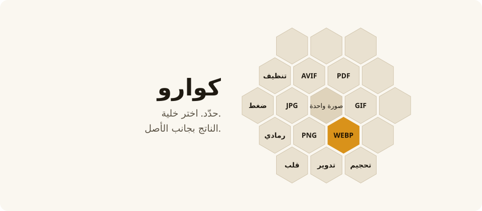
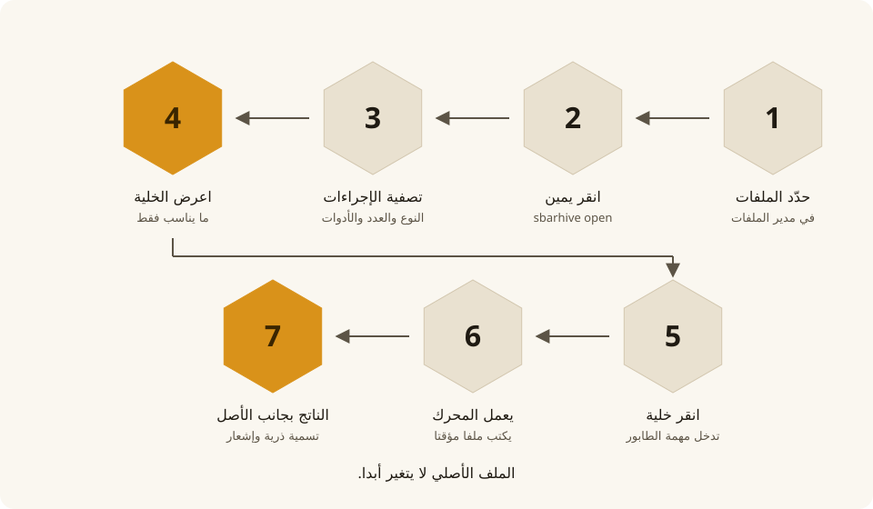
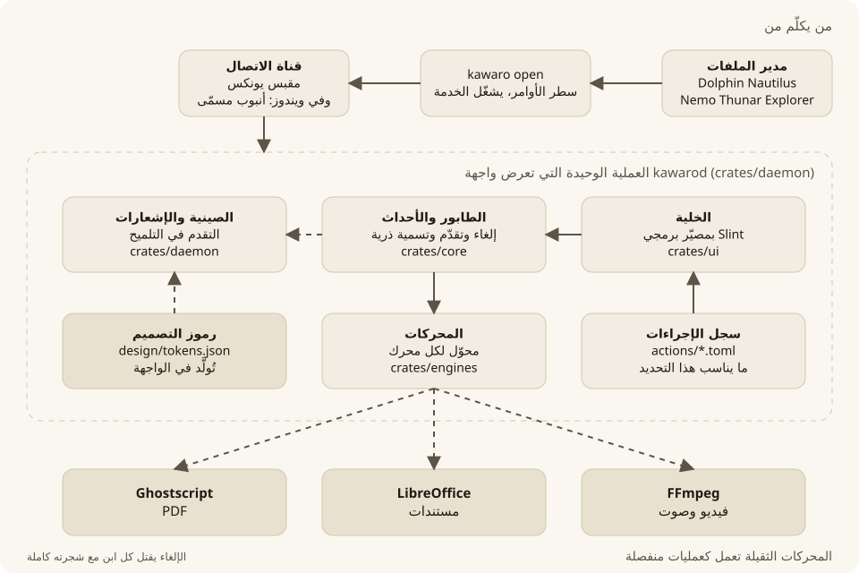

[English](README.md) | [العربية](README.ar.md)

الموقع: <https://kawaro.sbarah.com/>

<div dir="rtl">

# كوارو

حدّد ملفاتك في مدير الملفات، وافتح كوارو من قائمة النقر اليمين، ثم اختر من الخلية ما تريد. يُحفظ الناتج بجانب الملف الأصلي، ولا يُمس الأصل.

يعمل كل شيء على جهازك: لا رفع ولا خوادم ولا جمع بيانات.

<picture><source media="(prefers-color-scheme: dark)" srcset="docs/diagrams/hero.ar.dark.svg"></picture>

رسم مأخوذ من هندسة التطبيق نفسها ورموز التصميم.

## ماذا يفعل

- **الصور:** التحويل بين PNG وJPEG وWebP وAVIF وGIF وBMP وTIFF وICO، وتغيير الحجم، والتدوير، والقلب، والتدرج الرمادي، والضغط، وحذف البيانات الوصفية، وجمع عدة صور في ملف PDF واحد.
- **الفيديو والصوت** (الإصدار 0.2، يحتاج FFmpeg): التحويل إلى MP4 وWebM وGIF، واستخراج الصوت، وتحويل الصوت بين MP3 وOGG وFLAC وWAV وM4A وOpus، وضغط الفيديو.
- **المستندات وPDF** (الإصدار 0.2، يحتاج LibreOffice وGhostscript): تحويل مستندات Office وODF إلى PDF، والتحويل بين DOCX وODT في الاتجاهين، وضغط ملفات PDF ودمجها وتدويرها، وتحويل صفحاتها إلى صور.

لا تعرض الخلية إلا ما يناسب الملفات المحددة: نوعها، وعددها، والأدوات المثبتة على جهازك.

## الاسم

«كوارو» (Kawaro) مأخوذ من «كوّارة»، وهي كلمة عربية قديمة لخلية النحل. التطبيق خلية من الإجراءات، فاختصرنا الكلمة إلى اسم يُقرأ بالعربية واللاتينية بالطريقة نفسها: كوارو. والشعار كوّارة تقليدية مقبّبة داخل خلية سداسية واحدة.

## كيف يعمل

<picture><source media="(prefers-color-scheme: dark)" srcset="docs/diagrams/flow.ar.dark.svg"></picture>

<picture><source media="(prefers-color-scheme: dark)" srcset="docs/diagrams/overview.ar.dark.svg"></picture>

- **خدمة واحدة تعرض الواجهة.** `kawarod` فيها الخلية وطابور المهام والصينية والمحركات، و`kawaro` عميل خفيف.
- **المحركات الثقيلة عمليات منفصلة** (FFmpeg وLibreOffice وGhostscript)، وتُقتل مع شجرتها كاملة عند الإلغاء.
- **صيغة جديدة تعني ملف TOML واحدا** في `actions/` ومحوّلا صغيرا ([مخطط](docs/diagrams/extend.ar.light.svg)).
- **تختار الخلية سطحها** عند كل عرض ([مخطط](docs/diagrams/surface.ar.light.svg))، و**التحديثات موقّعة** ([مخطط](docs/diagrams/updates.ar.light.svg)).
- المخططات تُولَّد بالأمر `python3 design/diagrams/build.py` من `design/tokens.json`. والعقود الكاملة في [`docs/architecture.md`](docs/architecture.md).

## حالة الدعم

| النظام | الاختبار | ما يعمل |
|---|---|---|
| Hyprland 0.56 | جُرِّب | يعمل طبقةً عند المؤشر، مع الإفلات والضغط المطوّل |
| KDE Plasma 6 (KWin 6.7) | جُرِّب | يعمل طبقةً، مع التركيز والإفلات والاختصار |
| GNOME 50 | جُرِّب | يعمل نافذةً في المنتصف |
| Sway وwlroots | لم يُجرَّب | يُتوقع أن يعمل طبقةً |
| X11 | غير مدعوم بعد | ضمن الخطة |
| Fedora 41 وما بعده (RPM)، وUbuntu 22.04 و24.04 وDebian 12 (DEB) | جُرِّب | تُثبَّت الحزم وتعمل |
| ويندوز 10 و11 | تجريبي، لم يُختبر على جهاز حقيقي بعد | ملف مضغوط وحزمة MSI للمستخدم، قائمة الزر الأيمن، أيقونة شريط المهام |
| ماك | غير مدعوم بعد | ضمن الخطة |

## التثبيت

يعمل الإصدار الحالي على لينكس (64 بت).

**الأسهل:** نزّل الحزمة المناسبة لنظامك من [صفحة الإصدارات](https://github.com/M7MMAD-OMAR/kawaro/releases) وافتحها بمثبّت البرامج، أو من الطرفية:

```bash
sudo dnf install ./kawaro-*.x86_64.rpm     # Fedora
sudo apt install ./kawaro_*_amd64.deb      # Ubuntu وDebian
```

تضيف الحزمة كوارو إلى قائمة النقر اليمين في Dolphin وNautilus وNemo، وتشغّل الخدمة مع كل جلسة. أعد فتح مدير الملفات بعد التثبيت. أما Thunar فاستعمل له سكربت التثبيت أدناه.

**من المصدر:** تحتاج Rust 1.85 أو أحدث.

```bash
git clone https://github.com/M7MMAD-OMAR/kawaro
cd kawaro
./scripts/install.sh
```

يثبّت السكربت البرنامج لحسابك وحده دون صلاحيات المدير، ويضيف كوارو إلى قائمة النقر اليمين في مديري الملفات الموجودين عندك (Dolphin وNautilus وNemo وThunar)، ويشغّل الخدمة مع الجلسة. للإزالة: `./scripts/uninstall.sh`.

في الطريقتين يحتاج Nautilus إلى `nautilus-python` (Fedora) أو `python3-nautilus` (Ubuntu)، ويحتاج الفتح من الحافظة إلى `wl-clipboard` على Wayland أو `xclip` على X11.

**الإصدار:** كوارو 0.4.0 هو أول إصدار رسمي للينكس وويندوز في [صفحة الإصدارات](https://github.com/M7MMAD-OMAR/kawaro/releases)، ومعه ملف `SHA256SUMS` للتحقق من تنزيلك. ملفات ويندوز موقَّعة بشهادة اختبار ذاتية التوقيع وليست من جهة موثوقة، فتحذّر SmartScreen، والطريق: «More info» ثم «Run anyway» بعد التحقق من التنزيل (انظر [docs/windows-smartscreen.ar.md](docs/windows-smartscreen.ar.md)). اقرأ [ملاحظات الإصدار](docs/release-notes-0.4.0.ar.md) أولاً بما فيها الثغرات المعروفة.

## Windows beta: النسخة التجريبية

نسخة تجريبية لـ Windows 10 (الإصدار 22H2) وWindows 11 جاهزة للتجربة، وهي للمختبِرين. قائمة الفحص في [docs/windows-beta-checklist.md](docs/windows-beta-checklist.md) (بالإنجليزية).

**ما يعمل:** بند قائمة الزر الأيمن في المستكشف، ونافذة الخلية عند المؤشر، والتحويل بالمحركات المذكورة أدناه، وخلية الإفلات، وتشغيل الخدمة عند تسجيل الدخول. **وللتحويل أثناء السحب:** اسحب الملف بزر الفأرة الأيمن فتظهر الخلية أثناء السحب، عند الملف المسحوب. ولا يُضغط أي مفتاح أثناء السحب، فيبقى سلوك Explorer مع السحب كما هو: الإفلات خارج الخلية ينسخ أو ينقل أو ينشئ اختصارات كما دائماً، والملف الأصلي لا يُمس. وأيقونة شريط النظام والاختصار العام وإشعار انتهاء المهمة مبنية لكنها لم تُفحص على ويندوز حقيقي بعد (والفحص ملك S-079). أوقف الخدمة من قائمة أيقونة شريط النظام («إنهاء»)، أو من مدير المهام (أنهِ `kawarod.exe`)؛ ولم تثبيت كوارو شغّل أداة الإزالة.

**التثبيت.** نزّل من صفحة الإصدار `kawaro-<version>-windows-x64.msi` (للمستخدم الحالي دون صلاحيات المدير) أو `kawaro-<version>-windows-x64.zip` (محمول). كلتاهما غير موقّعة، فتسألك SmartScreen أولاً: اضغط «More info» ثم «Run anyway». وعلى Windows 11 يظهر بند كوارو تحت «Show more options» (إظهار خيارات إضافية) في قائمة الزر الأيمن، وعلى Windows 10 يظهر في القائمة مباشرة.

**المحركات غير مضمّنة.** محركات LibreOffice وGhostscript وFFmpeg غير مضمّنة، فثبّت ما تحتاجه منها. وإن غاب محرك ذكرت رسالة الخطأ اسمه.

**الإعدادات.** ملف الإعدادات على ويندوز هو `%APPDATA%\Kawaro\config.toml` (وعلى لينكس `~/.config/kawaro/config.toml`).

**أرسل نتائجك.** شغّل `scripts\windows\beta-smoke.cmd` ثم `scripts\windows\collect-logs.cmd`، وتجد النتائج في `%USERPROFILE%\kawaro-beta-test`. لا يُرفع شيء.

## سطر الأوامر

```bash
kawaro convert --to webp صورة.png        # تحويل مباشر دون الخدمة
kawaro actions *.jpg                     # ما تعرضه الخلية لهذه الملفات
kawaro open --from-clipboard             # فتح الخلية للملفات المنسوخة
```

على Hyprland يمكنك ربط Super مع النقر اليمين لتفتح الخلية للملفات المحددة مباشرة، والطريقة في [دليل Hyprland](integrations/linux/hyprland/README.ar.md).

ولتظهر الخلية وأنت تسحب ملفاً، اربط الأمر `kawaro drop` باختصار، والافتراضي Super+Z. خطوات GNOME وKDE وHyprland في [اختصار الإفلات](docs/drop-shortcut.ar.md).

## الإعدادات

افتح الإعدادات من أيقونة كوارو في شريط النظام، أو عدّل الملف `~/.config/kawaro/config.toml` مباشرة، وفيه اللغة والمظهر ومكان الناتج (بجانب الأصل أو في مجلد فرعي) ومستوى الجودة. وإجراءاتك الخاصة تضعها في ملفات TOML داخل `~/.config/kawaro/actions/`.

على ويندوز يكون ملف الإعدادات في `%APPDATA%\Kawaro\config.toml`، والإجراءات الخاصة في `%APPDATA%\Kawaro\actions\`. وسجل الخدمة في `%LOCALAPPDATA%\Kawaro\logs\kawarod.log`.

**حزم ويندوز التجريبية غير موقّعة.** الملف المضغوط المحمول وحزمة MSI للمستخدم الحالي (S-051) بلا شهادة توقيع، فتعرض SmartScreen في ويندوز عبارة «Windows protected your PC»: اضغط «More info» ثم «Run anyway». قارن قيمة SHA-256 للملف الذي نزّلته بالقيمة المنشورة في صفحة الإصدار قبل تشغيله. لا تحتاج أي حزمة إلى صلاحيات المدير، ولم يُتحقق من أي منهما على ويندوز حقيقي بعد (S-052).

وعلى ويندوز يشغّل `kawaro open` الخدمة `kawarod.exe` من مجلد البرنامج إن لم تكن تعمل، والمقصود أن تبقى تعمل بعد إغلاق الطرفية. ولم يُتحقق من هذا السلوك حياً بعد (S-052).

ولا ينزّل كوارو المحركات الخارجية على ويندوز، بل يبحث عنها في `PATH` أولاً، ثم في مجلدات تثبيتها المعتادة: LibreOffice في `%ProgramFiles%\LibreOffice\program`، وGhostscript في أحدث `%ProgramFiles%\gs\gs*\bin`، وFFmpeg في المجلد `ffmpeg\bin` بجانب `kawaro.exe`، ثم في سجل ويندوز لـ LibreOffice وGhostscript. وإن لم يجد محركاً ذكرت رسالة الخطأ اسمه ورابط تنزيله.

المفتاح `hold_ms` مدة الضغط المطوّل بالملي ثانية قبل أن تظهر الخلية مع `kawaro drop --hold`: الافتراضي 400، والمقبول من 100 إلى 2000، وأي قيمة أخرى تعيد الافتراضي مع تحذير في السجل. يُقرأ عند كل ضغطة، فيسري تعديله دون إعادة تشغيل الخدمة. ولا تعرضه نافذة الإعدادات، فعدّله في الملف.

## المساهمة

اقرأ [دليل المساهمة](CONTRIBUTING.ar.md) و`docs/architecture.md` قبل أي تعديل. للإبلاغ عن ثغرة أمنية راجع `SECURITY.md`، وسجل الإصدارات في `CHANGELOG.md`. إضافة صيغة جديدة تعني ملف TOML في `actions/` ومحوّلاً صغيراً في `crates/engines/`.

## الدعم

كوارو مجاني ويُبنى بشكل مفتوح. إن أفادك، يمكنك دعم تطويره:

<a href="https://sbarah.com/support"><picture><source media="(prefers-color-scheme: dark)" srcset="docs/assets/support-sbarah-dark.svg"></picture></a>

## الرخصة

GPLv3 أو أحدث (GPL-3.0-or-later). راجع `LICENSE`.

</div>
