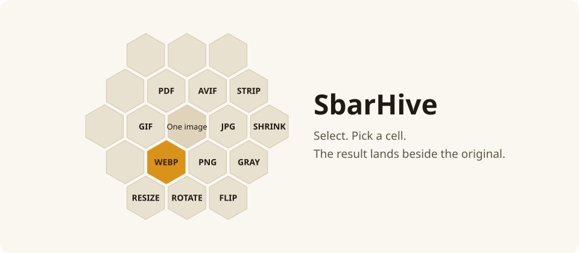
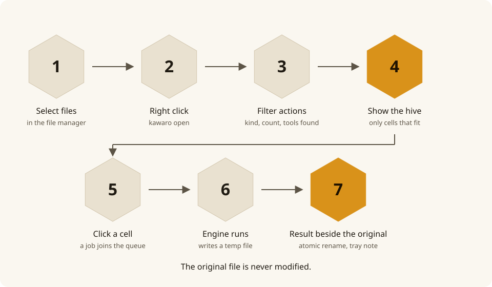
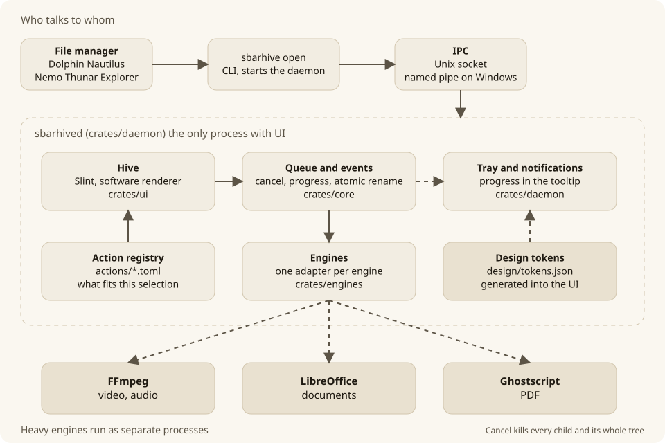
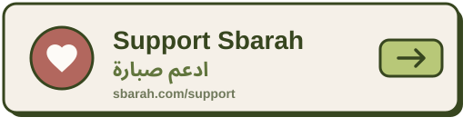

[English](README.md) | [العربية](README.ar.md)

Website: <https://kawaro.sbarah.com/>

# Kawaro

Select files in your file manager, open Kawaro from the right-click menu,
and pick an action from the hive. The result is saved next to the original,
which is never modified.

Everything runs on your machine: no uploads, no servers, no telemetry.

<picture><source media="(prefers-color-scheme: dark)" srcset="docs/diagrams/hero.en.dark.svg"></picture>

Illustration drawn from the app's own geometry and design tokens.

## What it does

- **Images:** convert between PNG, JPEG, WebP, AVIF, GIF, BMP, TIFF and ICO;
  resize, rotate, flip, grayscale, compress, strip metadata, and combine
  several images into one PDF.
- **Video and audio** (v0.2, needs FFmpeg): convert to MP4, WebM and GIF,
  extract the audio track, convert audio between MP3, OGG, FLAC, WAV, M4A and
  Opus, compress video.
- **Documents and PDF** (v0.2, needs LibreOffice and Ghostscript): Office and
  ODF documents to PDF, DOCX and ODT both ways, compress, merge and rotate
  PDFs, turn pages into images.

The hive only offers what fits the selection: file kind, file count, and the
tools installed on your system.

## The name

Kawaro comes from «كوّارة» (kawwara), an old Arabic word for a beehive. The app is a hive of actions, so we took the word and shortened it to a name that reads the same in Arabic and Latin script: ka-wa-ro. The mark is a saguaro cactus built from many hive cells on the honeycomb lattice; the single hexagon with the cactus cut out is the app icon.

## How it works

<picture><source media="(prefers-color-scheme: dark)" srcset="docs/diagrams/flow.en.dark.svg"></picture>

<picture><source media="(prefers-color-scheme: dark)" srcset="docs/diagrams/overview.en.dark.svg"></picture>

- **One service shows UI.** `kawarod` holds the hive, the job queue, the tray and the engines; `kawaro` is a thin client.
- **Heavy engines are separate processes** (FFmpeg, LibreOffice, Ghostscript), killed with their whole tree on cancel.
- **A new format is one TOML file** in `actions/` plus a small adapter ([diagram](docs/diagrams/extend.en.light.svg)).
- **The hive picks its surface** at every show ([diagram](docs/diagrams/surface.en.light.svg)) and **updates are signed** ([diagram](docs/diagrams/updates.en.light.svg)).
- The diagrams are generated by `python3 design/diagrams/build.py` from `design/tokens.json`. The full contracts are in [`docs/architecture.md`](docs/architecture.md).

## Download and install

Candidate: **0.5.1**, dated 2026-11-05 ([release notes](docs/release-notes-0.5.1.md)). The current public release remains **0.5.0** until the new tag and publication are verified. These install links select published releases, not unverified candidate packages.

Get the latest release from the [releases page](https://github.com/M7MMAD-OMAR/kawaro/releases/latest), or from [kawaro.sbarah.com](https://kawaro.sbarah.com/).

| System | File | How |
|---|---|---|
| Windows 10 and 11 | `kawaro-<version>-windows-x64.msi` | Double click. Installs for your user, no administrator rights. |
| Fedora | `kawaro-<version>-1.x86_64.rpm` | `sudo dnf install ./kawaro-*.x86_64.rpm` |
| Ubuntu, Debian | `kawaro_<version>_amd64.deb` | `sudo apt install ./kawaro_*_amd64.deb` |

Every release has a `SHA256SUMS` file to verify your download. Package channels and what is live (apt and Scoop are live, WinGet waits for review, AUR and COPR wait for accounts): [distribution guide](docs/distribution.md). After installing, reopen your file manager and right-click a file.

**Windows warning.** The Windows files are signed with a self-signed test certificate, so SmartScreen warns on first run: click "More info", then "Run anyway" ([details](docs/windows-smartscreen.md)). On Windows 11 the Kawaro item is under "Show more options". A trusted certificate is not available to the project for now; Scoop is another install route; WinGet is not installable until moderator approval.

**Updates.** Kawaro checks for new versions and updates itself: Settings, Updates shows the installed version, "Check for updates" and "Update now". The command line does the same with `kawaro update`.

**Linux extras.** The package adds Kawaro to the right-click menu of Dolphin, Nautilus and Nemo and starts the service with every session. Nautilus needs `nautilus-python` (Fedora) or `python3-nautilus` (Ubuntu). Opening from the clipboard needs `wl-clipboard` on Wayland or `xclip` on X11.

**From source** (Rust 1.85 or newer, Linux):

```bash
git clone https://github.com/M7MMAD-OMAR/kawaro
cd kawaro
./scripts/install.sh      # your user only, no root; remove with ./scripts/uninstall.sh
```

**Engines.** FFmpeg, LibreOffice and Ghostscript are not bundled; install the ones you need. A missing engine gives an error that names it. On Windows Kawaro looks in `PATH`, then in the usual install folders.

## Platform support

| Platform | Tested | What works |
|---|---|---|
| Windows 10 and 11 | Tested in a virtual Windows 11 machine, historical baseline only | New customization UI runtime and physical hardware unverified; self-signed, SmartScreen warns |
| Hyprland | Tested in the accepted private native S-139/S-140 scope | Layer/window paths checked in that scope, not universal desktop acceptance |
| KDE Plasma and GNOME | Virtual/private compositor evidence only | Real desktop focus/activation remains open, [issue #1](https://github.com/M7MMAD-OMAR/kawaro/issues/1) |
| Fedora, Ubuntu and Debian packages | Tested historical release packages only | 0.5.1 packages and channels not yet verified |
| Sway and wlroots | Not tested | Layer path not accepted here |
| X11 | Tested only in a private virtual X server with xfwm4 | Real GNOME/KDE X11 desktops and file-manager drag sources remain unverified |
| macOS | Not supported | No runtime acceptance |

S-138 whole-output far coverage and final position remain unverified. Fresh under-150 ms show/preview timing, IME, physical hotplug, legacy Hyprlang runtime and separate compositor Closed injection remain unverified. Bare Alt is not a supported GNOME/KDE portal shortcut; use a supported chord such as Super+Z.

## Windows

Right-click a file in Explorer and choose Kawaro. To convert while you drag, drag the file with the right mouse button: the hive opens at the dragged file. No key is held, so Explorer keeps its own drag behaviour, and a drop outside the hive copies, moves or links as usual. The original file is never touched. Stop the service from the tray icon menu (Quit); uninstall from Settings, Apps. The tray icon, the global shortcut and the end-of-job notification are still being checked on real machines.

## Command line

```bash
kawaro convert --to webp photo.png    # convert here, no service needed
kawaro actions *.jpg                  # what the hive offers for these files
kawaro open --from-clipboard          # open the hive for copied files
```

**MCP for local AI apps.** `kawaro mcp` can serve the same actions to a
local AI host over stdio, off by default and read-only first. Restrict
`allowed_roots`, opt in to writes, and configure audit logging as needed.
Kawaro processes files locally; the host has its own privacy policy for tool
results. See [Use Kawaro from a local AI app](docs/mcp.md).

On Hyprland you can bind Super plus right-click to open the hive for the
selected files directly; see
[the Hyprland guide](integrations/linux/hyprland/README.md).

To show the hive while you drag a file, bind `kawaro drop` to a shortcut,
Super+Z by default; GNOME, KDE and Hyprland steps are in
[Drop shortcut](docs/drop-shortcut.md).

DropFirst is the default; an existing saved choose-during-drag preference is preserved. The customization preview is a source draft, not rendered output. On Hyprland, `kawaro doctor --repair` updates only the generated owned binding file, which must be sourced by your active configuration. Custom legacy Kawaro sections need equivalent S-140 updates manually; foreign bindings are not edited. See the [release notes](docs/release-notes-0.5.1.md) for optional system engines (qpdf is not downloaded) and validation limits.

## Settings

Open Settings from the Kawaro tray icon. It has pages for general options (language, theme), conversion (output place, quality), notifications and integration, updates, and About with the version and the website. You can also edit `config.toml`: `~/.config/kawaro/config.toml` on Linux, `%APPDATA%\Kawaro\config.toml` on Windows. Your own actions go in `actions/*.toml` next to it. The Windows service log is `%LOCALAPPDATA%\Kawaro\logs\kawarod.log`.

`hold_ms` is the long press, in milliseconds, before `kawaro drop --hold` shows the hive: 400 by default, accepted from 100 to 2000. It is read at every press and is not in the settings window; edit the file.

## Contributing

Read [CONTRIBUTING.md](CONTRIBUTING.md) and `docs/architecture.md` first.
Security reports: see `SECURITY.md`. Release history: `CHANGELOG.md`. A new
format is one TOML file in `actions/` plus a small adapter in
`crates/engines/`.

## Website and docs

Guides, formats, releases and downloads: <https://kawaro.sbarah.com/> (Arabic and English). The pages are built from `docs/guide/`, `actions/` and `CHANGELOG.md` by `scripts/build-site.sh`.

## Support

Kawaro is free and built in the open. If it helps you, you can support its development:

<a href="https://sbarah.com/support"><picture><source media="(prefers-color-scheme: dark)" srcset="docs/assets/support-sbarah-dark.svg"></picture></a>

## Distribution and signing

Current release: 0.5.1. This source is the candidate release cut, not a verified published tag; public packages remain 0.5.0 until publication is complete. apt and Scoop are live and update on every release. The WinGet package (`Sbarah.Kawaro`) passed all automated checks and waits for a volunteer moderator since 2026-10-27, so it is not installable yet. AUR and COPR wait for accounts that only a person can create. The maintainer has no code signing certificate available, so the Windows build stays self-signed and SmartScreen warns; the Microsoft Store and SignPath are parked, not planned for now. Details: [distribution status](docs/distribution-status.md) and the [code signing policy](CODE_SIGNING_POLICY.md).

## License

GPL-3.0-or-later. See `LICENSE`.

- drop-first by default: drop the files, then choose; see
  [docs/drop-shortcut.md](docs/drop-shortcut.md).