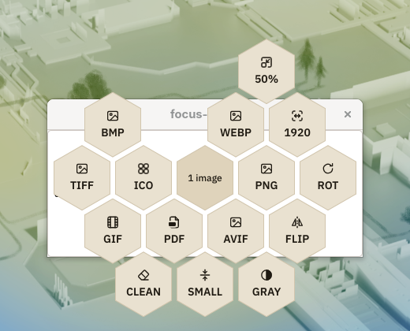

<div dir="rtl">

# صبار هايف

حدّد ملفاتك في مدير الملفات، وافتح صبار هايف من قائمة النقر اليمين، واختر من الخلية ما تريد. يُحفظ الناتج بجانب الملف الأصلي، ولا يُمس الأصل.

يعمل كل شيء على جهازك: لا رفع ولا خوادم ولا جمع بيانات.



## ماذا يفعل

- **الصور:** تحويل بين PNG وJPEG وWebP وAVIF وGIF وBMP وTIFF وICO، وتغيير الحجم، والتدوير، والقلب، والتدرج الرمادي، والضغط، وحذف البيانات الوصفية، وجمع عدة صور في ملف PDF واحد.
- **الفيديو والصوت** (الإصدار 0.2، يحتاج FFmpeg): تحويل إلى MP4 وWebM وGIF، واستخراج الصوت، وتحويل الصوت بين MP3 وOGG وFLAC وWAV وM4A وOpus، وضغط الفيديو.
- **المستندات وPDF** (الإصدار 0.2، يحتاج LibreOffice وGhostscript): تحويل مستندات Office وODF إلى PDF، والتحويل بين DOCX وODT، وضغط PDF ودمجه وتدويره وتحويل صفحاته إلى صور.

تعرض الخلية ما يناسب الملفات المحددة فقط: نوعها وعددها، والأدوات المثبتة على جهازك.

## التثبيت

يعمل الإصدار الحالي على لينكس. تحتاج Rust 1.85 أو أحدث.

```bash
git clone https://github.com/M7MMAD-OMAR/sbarhive
cd sbarhive
./scripts/install.sh
```

يثبّت السكربت البرنامج لحسابك وحده دون صلاحيات المدير، ويضيف عنصر صبار هايف إلى قائمة النقر اليمين في مديري الملفات الموجودين عندك (Dolphin وNautilus وNemo وThunar)، ويشغّل الخدمة مع الجلسة. للإزالة: `./scripts/uninstall.sh`.

يحتاج Nautilus إلى حزمة `nautilus-python`، ويحتاج الفتح من الحافظة إلى `wl-clipboard` على Wayland أو `xclip` على X11.

## الاستعمال من سطر الأوامر

```bash
sbarhive convert --to webp صورة.png        # تحويل مباشر دون الخدمة
sbarhive actions *.jpg                     # ما تعرضه الخلية لهذه الملفات
sbarhive open --from-clipboard             # فتح الخلية للملفات المنسوخة
```

على Hyprland يمكن ربط Super مع النقر اليمين بفتح الخلية للملفات المحددة مباشرة. الطريقة في `integrations/linux/hyprland/README.md`.

## الإعدادات

افتح الإعدادات من أيقونة صبار هايف في شريط النظام، أو عدّل `~/.config/sbarhive/config.toml` مباشرة: اللغة، والمظهر، ومكان الناتج (بجانب الأصل أو في مجلد فرعي)، ومستوى الجودة. ويمكن إضافة إجراءات خاصة بك بملفات TOML في `~/.config/sbarhive/actions/`.

## المساهمة

اقرأ `CONTRIBUTING.md` و`docs/architecture.md` قبل أي تعديل. للإبلاغ عن ثغرة أمنية راجع `SECURITY.md`، وسجل التغييرات في `CHANGELOG.md`. إضافة صيغة جديدة تعني ملف TOML في `actions/` ومحوّلا صغيرا في `crates/engines/`.

## الرخصة

GPLv3 أو أحدث. راجع `LICENSE`.

</div>

---

# SbarHive

Select files in your file manager, open SbarHive from the right-click menu,
and pick an action from the hive. The result is saved next to the original,
which is never modified.

Everything runs on your machine: no uploads, no servers, no telemetry.


## What it does

- **Images:** convert between PNG, JPEG, WebP, AVIF, GIF, BMP, TIFF and ICO;
  resize, rotate, flip, grayscale, compress, strip metadata, and combine
  several images into one PDF.
- **Video and audio** (v0.2, needs FFmpeg): convert to MP4, WebM and GIF,
  extract the audio track, convert audio between MP3, OGG, FLAC, WAV, M4A and
  Opus, compress video.
- **Documents and PDF** (v0.2, needs LibreOffice and Ghostscript): Office and
  ODF documents to PDF, DOCX and ODT both ways, compress, merge and rotate
  PDFs, turn pages into images.

The hive only offers what fits the selection: file kind, file count, and the
tools installed on your system.

## Install

Linux for now. Requires Rust 1.85 or newer.

```bash
git clone https://github.com/M7MMAD-OMAR/sbarhive
cd sbarhive
./scripts/install.sh
```

The script installs for your user only, without root. It adds a SbarHive
entry to the right-click menu of the file managers it finds (Dolphin,
Nautilus, Nemo, Thunar) and starts the service with your session. To remove
it: `./scripts/uninstall.sh`.

Nautilus needs `nautilus-python`. Opening from the clipboard needs
`wl-clipboard` on Wayland or `xclip` on X11.

## Command line

```bash
sbarhive convert --to webp photo.png    # convert here, no service needed
sbarhive actions *.jpg                  # what the hive offers for these files
sbarhive open --from-clipboard          # open the hive for copied files
```

On Hyprland you can bind Super plus right-click to open the hive for the
selected files directly; see `integrations/linux/hyprland/README.md`.

## Settings

Open Settings from the SbarHive tray icon, or edit `~/.config/sbarhive/config.toml`, which holds the language, theme, output place
(next to the original or in a subfolder) and quality preset. Your own actions
go in `~/.config/sbarhive/actions/*.toml`.

## Contributing

Read `CONTRIBUTING.md` and `docs/architecture.md` first. Security reports:
see `SECURITY.md`. Release history: `CHANGELOG.md`. A new format is one TOML
file in `actions/` plus a small adapter in `crates/engines/`.

## License

GPL-3.0-or-later. See `LICENSE`.
