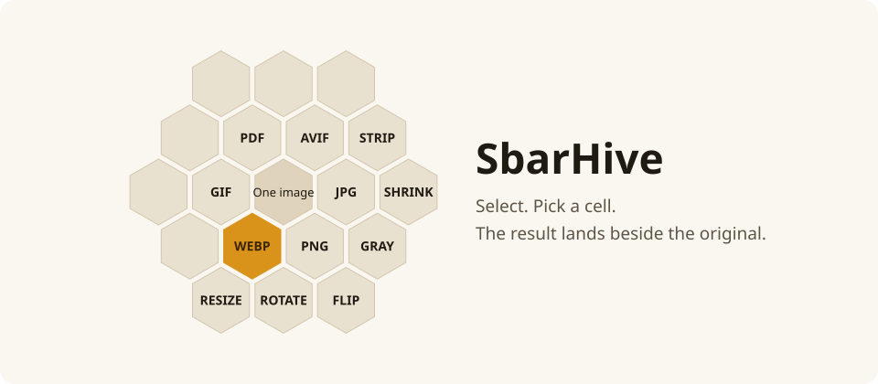
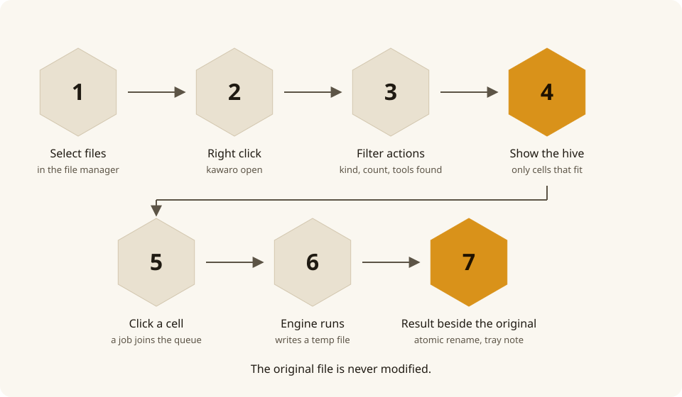
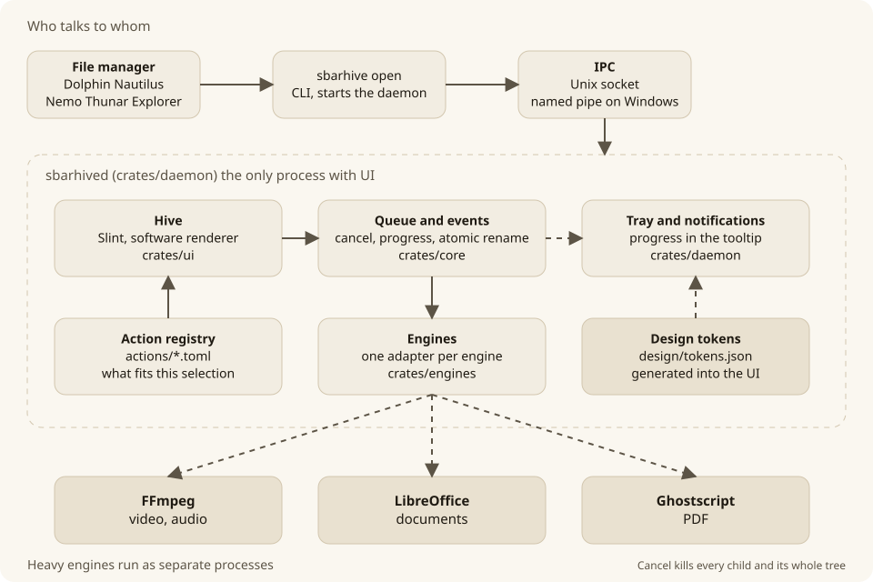

[English](README.md) | [العربية](README.ar.md)

Website: <https://kawaro.sbarah.com/>

# Kawaro

Select files in your file manager, open Kawaro from the right-click menu,
and pick an action from the hive. The result is saved next to the original,
which is never modified.

Everything runs on your machine: no uploads, no servers, no telemetry.

<picture><source media="(prefers-color-scheme: dark)" srcset="docs/diagrams/hero.en.dark.svg"></picture>

Illustration drawn from the app's own geometry and design tokens.

## What it does

- **Images:** convert between PNG, JPEG, WebP, AVIF, GIF, BMP, TIFF and ICO;
  resize, rotate, flip, grayscale, compress, strip metadata, and combine
  several images into one PDF.
- **Video and audio** (v0.2, needs FFmpeg): convert to MP4, WebM and GIF,
  extract the audio track, convert audio between MP3, OGG, FLAC, WAV, M4A and
  Opus, compress video.
- **Documents and PDF** (v0.2, needs LibreOffice and Ghostscript): Office and
  ODF documents to PDF, DOCX and ODT both ways, compress, merge and rotate
  PDFs, turn pages into images.

The hive only offers what fits the selection: file kind, file count, and the
tools installed on your system.

## The name

Kawaro comes from «كوّارة» (kawwara), an old Arabic word for a beehive. The app is a hive of actions, so we took the word and shortened it to a name that reads the same in Arabic and Latin script: ka-wa-ro. The mark is a traditional domed beehive inside one honeycomb cell.

## How it works

<picture><source media="(prefers-color-scheme: dark)" srcset="docs/diagrams/flow.en.dark.svg"></picture>

<picture><source media="(prefers-color-scheme: dark)" srcset="docs/diagrams/overview.en.dark.svg"></picture>

- **One service shows UI.** `kawarod` holds the hive, the job queue, the tray and the engines; `kawaro` is a thin client.
- **Heavy engines are separate processes** (FFmpeg, LibreOffice, Ghostscript), killed with their whole tree on cancel.
- **A new format is one TOML file** in `actions/` plus a small adapter ([diagram](docs/diagrams/extend.en.light.svg)).
- **The hive picks its surface** at every show ([diagram](docs/diagrams/surface.en.light.svg)) and **updates are signed** ([diagram](docs/diagrams/updates.en.light.svg)).
- The diagrams are generated by `python3 design/diagrams/build.py` from `design/tokens.json`. The full contracts are in [`docs/architecture.md`](docs/architecture.md).

## Platform support

| Platform | Tested | What works |
|---|---|---|
| Hyprland 0.56 | Tested | Works as a layer at the pointer, with drop and long press |
| KDE Plasma 6 (KWin 6.7) | Tested | Works as a layer, with focus, drop and the shortcut |
| GNOME 50 | Tested | Works as a centred window |
| Sway and wlroots | Not tested | Expected to work as a layer |
| X11 | Not supported yet | Planned |
| Fedora 41 and later (RPM), Ubuntu 22.04 and 24.04, Debian 12 (DEB) | Tested | The packages install and run |
| Windows 10 and 11 | Beta, not tested on a live machine yet | Zip and per-user MSI, right click menu, tray icon |
| macOS | Not supported yet | Planned |

## Install

Linux (64 bit) for now.

**Easiest:** download the package for your system from the
[latest release](https://github.com/M7MMAD-OMAR/kawaro/releases/latest)
and open it with your software installer, or:

```bash
sudo dnf install ./kawaro-*.x86_64.rpm     # Fedora
sudo apt install ./kawaro_*_amd64.deb      # Ubuntu, Debian
```

The package adds Kawaro to the right-click menu of Dolphin, Nautilus and
Nemo and starts the service with every session; reopen your file manager
after installing. For Thunar use the script below.

**From source:** requires Rust 1.85 or newer.

```bash
git clone https://github.com/M7MMAD-OMAR/kawaro
cd kawaro
./scripts/install.sh
```

The script installs for your user only, without root. It adds a Kawaro
entry to the right-click menu of the file managers it finds (Dolphin,
Nautilus, Nemo, Thunar) and starts the service with your session. To remove
it: `./scripts/uninstall.sh`.

Either way, Nautilus needs `nautilus-python` (Fedora) or `python3-nautilus`
(Ubuntu), and opening from the clipboard needs `wl-clipboard` on Wayland or
`xclip` on X11.

**Beta:** the first public beta, 0.4.0-beta.1, is a prerelease on the [releases page](https://github.com/M7MMAD-OMAR/kawaro/releases) for Linux and Windows, with a `SHA256SUMS` file to verify your download. Read its [release notes](docs/release-notes-0.4.0-beta.1.md) first, including the known gaps.

## Windows beta

A Windows 10 (22H2) and Windows 11 beta is ready to try. It is for testers: the checklist is in [docs/windows-beta-checklist.md](docs/windows-beta-checklist.md).

**What works:** the right-click menu entry in Explorer, the hive window at the pointer, conversions with the engines below, and the service starting at logon. **What does not exist yet:** the drop hive, the tray icon, the global shortcut and notifications. There is no tray icon yet, so stop the service from Task Manager (end `kawarod.exe`) or uninstall Kawaro.

**Install.** Download `kawaro-<version>-windows-x64.msi` (per user, no administrator rights) or `kawaro-<version>-windows-x64.zip` (portable) from the release page. Both are unsigned, so Windows SmartScreen asks first: click "More info", then "Run anyway". On Windows 11 the Kawaro item is under "Show more options" in the right-click menu; on Windows 10 it is in the menu directly.

**Engines are not bundled.** LibreOffice, Ghostscript and FFmpeg are not bundled; install the ones you need (see Settings below for where Kawaro looks). A missing engine gives an error that names it.

**Settings.** The settings file is `%APPDATA%\Kawaro\config.toml` on Windows (`~/.config/kawaro/config.toml` on Linux).

**Report back.** Run `scripts\windows\beta-smoke.cmd` and `scripts\windows\collect-logs.cmd`; results go to `%USERPROFILE%\kawaro-beta-test`. Nothing is uploaded.

## Command line

```bash
kawaro convert --to webp photo.png    # convert here, no service needed
kawaro actions *.jpg                  # what the hive offers for these files
kawaro open --from-clipboard          # open the hive for copied files
```

On Hyprland you can bind Super plus right-click to open the hive for the
selected files directly; see
[the Hyprland guide](integrations/linux/hyprland/README.md).

To show the hive while you drag a file, bind `kawaro drop` to a shortcut,
Super+Z by default; GNOME, KDE and Hyprland steps are in
[Drop shortcut](docs/drop-shortcut.md).

## Settings

Open Settings from the Kawaro tray icon, or edit
`~/.config/kawaro/config.toml`, which holds the language, theme, output
place (next to the original or in a subfolder) and quality preset. Your own
actions go in `~/.config/kawaro/actions/*.toml`.

On Windows the settings file is `%APPDATA%\Kawaro\config.toml`, your own
actions go in `%APPDATA%\Kawaro\actions\*.toml`. The service log is
`%LOCALAPPDATA%\Kawaro\logs\kawarod.log`.

**Windows beta packages are unsigned.** The portable zip and the per-user MSI (S-051) carry no code signing certificate, so Windows SmartScreen shows "Windows protected your PC": click "More info", then "Run anyway". Compare the SHA-256 of the file you downloaded with the one on the release page before you run it. Neither package needs administrator rights, and neither is verified on a live Windows system yet (S-052).

On Windows `kawaro open` starts the service, `kawarod.exe`, from the
program folder when it is not running, and it is meant to keep running after
the terminal closes. This behaviour is not verified live yet (S-052).

Kawaro does not download the external engines on Windows. It looks for
them in `PATH` first, then in their usual install folders: LibreOffice in
`%ProgramFiles%\LibreOffice\program`, Ghostscript in the newest
`%ProgramFiles%\gs\gs*\bin`, FFmpeg in the `ffmpeg\bin` folder next to
`kawaro.exe`, then in the Windows registry for LibreOffice and
Ghostscript. When an engine is missing, the error names it and links to its
download page.

`hold_ms` is the long press, in milliseconds, before `kawaro drop --hold`
shows the hive: 400 by default, accepted from 100 to 2000; any other value
falls back to the default with a warning in the log. It is read at every
press, so a change applies without restarting the daemon. The settings
window does not show it; edit the file.

## Contributing

Read [CONTRIBUTING.md](CONTRIBUTING.md) and `docs/architecture.md` first.
Security reports: see `SECURITY.md`. Release history: `CHANGELOG.md`. A new
format is one TOML file in `actions/` plus a small adapter in
`crates/engines/`.

## Website and docs

Guides, formats, releases and downloads: <https://kawaro.sbarah.com/> (Arabic and English). The pages are built from `docs/guide/`, `actions/` and `CHANGELOG.md` by `scripts/build-site.sh`.

## Support

Kawaro is free and built in the open. If it helps you, you can support its development:

<a href="https://sbarah.com/support"><picture><source media="(prefers-color-scheme: dark)" srcset="docs/assets/support-sbarah-dark.svg"></picture></a>

## License

GPL-3.0-or-later. See `LICENSE`.
